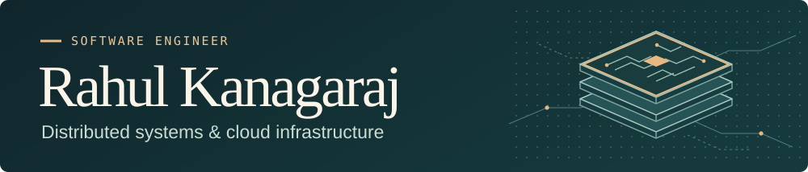

I work on private cloud infrastructure at **Platform9** while pursuing an M.S. in Computer Science at **UC Davis**. Before that, I built storage services at **HPE**. I’m particularly interested in how clusters behave during upgrades, under load, and when a node goes down.

[Portfolio](https://rahul-kanagaraj.vercel.app/) &nbsp;·&nbsp; [LinkedIn](https://www.linkedin.com/in/rahulkanagaraj/) &nbsp;·&nbsp; [Email](mailto:rahulkanagaraj@outlook.com)

## Experience

### Platform9

*Software Engineering Intern · Private Cloud Director · June 2026–present*

I develop and debug the workflows that install and upgrade private clouds across Kubernetes, OpenStack, and Linux. My work on production deployments improved the efficiency of those workflows by **nearly 50%**.

### Hewlett Packard Enterprise

*Software Engineer, R&D · HPE Alletra Storage · 2022–2025*

- **Event processing.** I built the infrastructure that routes S3 events for the Alletra Storage MP X10000. Python workers, Kafka, and gRPC on Kubernetes handled **10,000+ events per minute at sub-second latency**, triggering metadata extraction and vector embedding generation.
- **Cluster setup and failover.** I built Go services for node discovery and configuration that cut setup time by **30%**. I also integrated Keepalived and VRRP so storage services could fail over when a node or network link went down.
- **Production debugging.** I added network counters across the storage stack, cutting the time support engineers spent debugging incidents by **40%**.

## Selected projects

### [Dev2Prod](https://github.com/sanjayb-28/Dev2Prod)

Sanjay Baskaran and I built a Kubernetes lab where we could restart pods with Chaos Mesh and measure how scaling and caching affected p95 latency under k6 load tests. One burst test exposed a PostgreSQL connection bottleneck. We fixed it by pooling connections and keeping cache hits off the database. [Project write-up](https://devpost.com/software/dev2prod)

| Project | What I worked on |
| --- | --- |
| [ResMCP](https://github.com/apache/resilientdb/tree/master/ecosystem/ai-tools/mcp/resilientdb-mcp) | Co-built the Model Context Protocol server now in Apache ResilientDB. Agents can submit transactions through GraphQL and read or write key-value data over HTTP. |
| [MCPShield](https://github.com/rahulkanagaraj786/mcp-security-analysis) | Built a security layer for MCP clients and servers, including file-path validation and checks on untrusted plugins. |
| [LLM routing study](https://github.com/rahulkanagaraj786/llm-routing-study) | Trained a router to choose between GPT-5 and Gemini 2.5 Flash from the prompt alone, then measured the cost and accuracy of those choices on held-out questions. |
